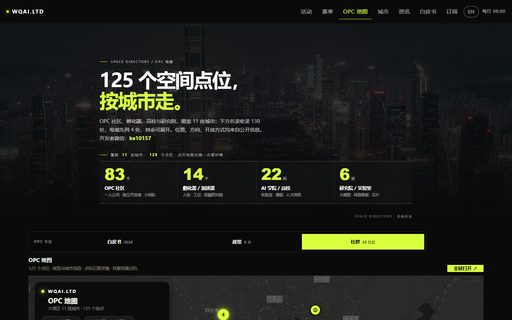
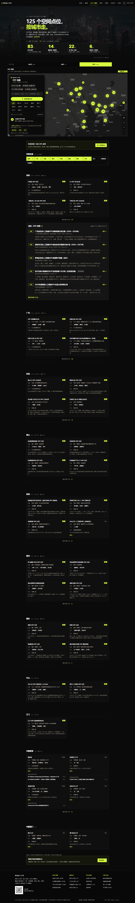
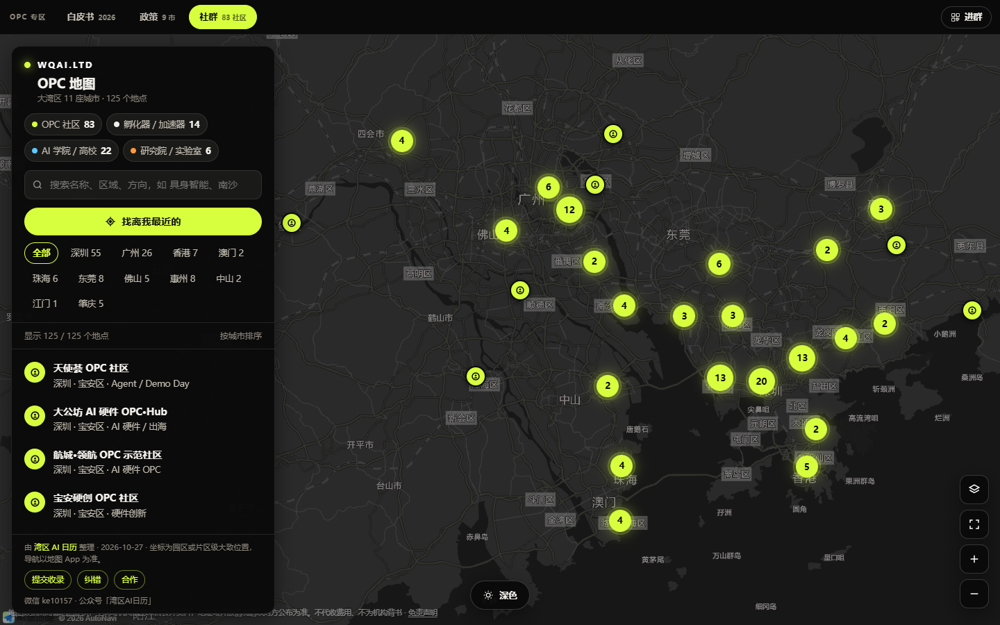
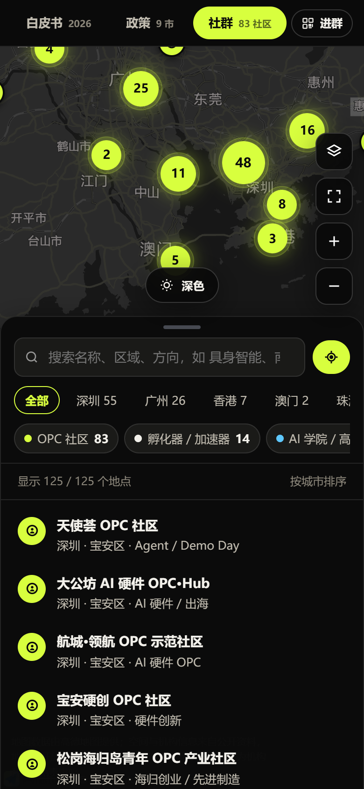
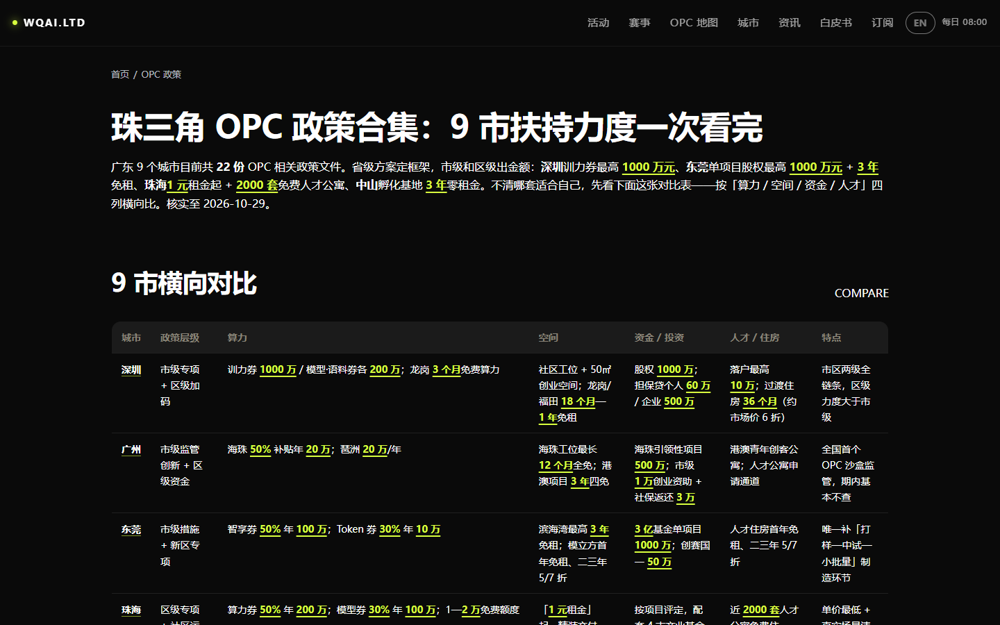
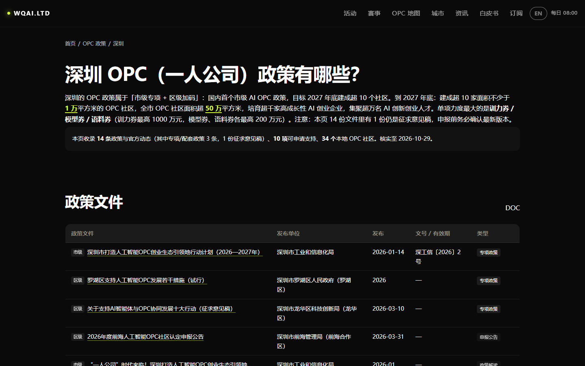
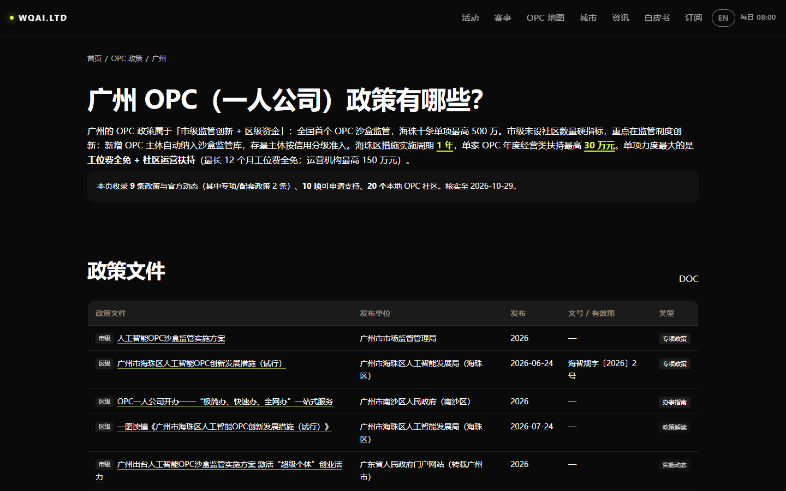
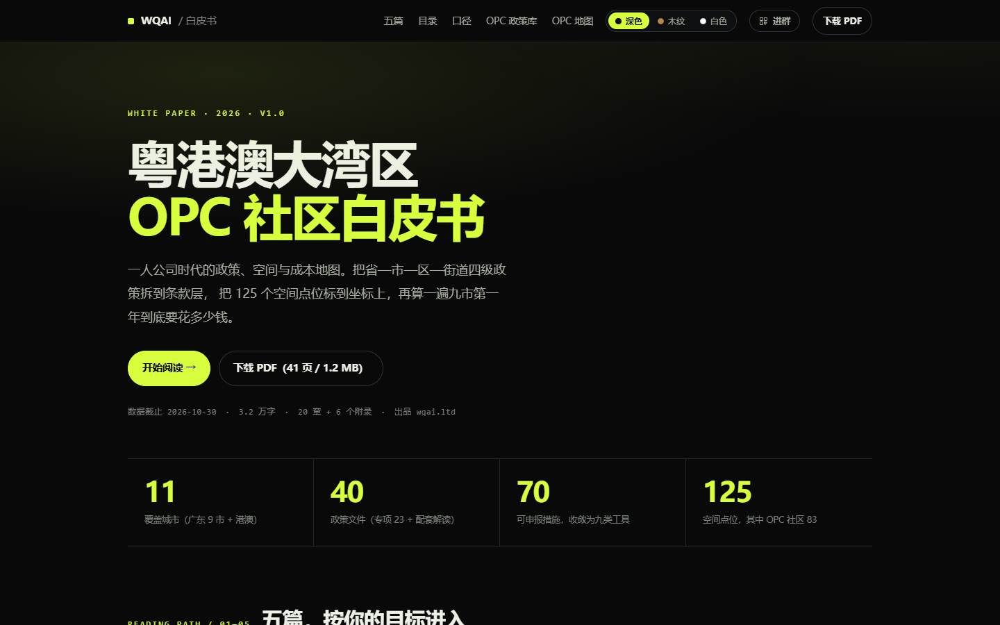
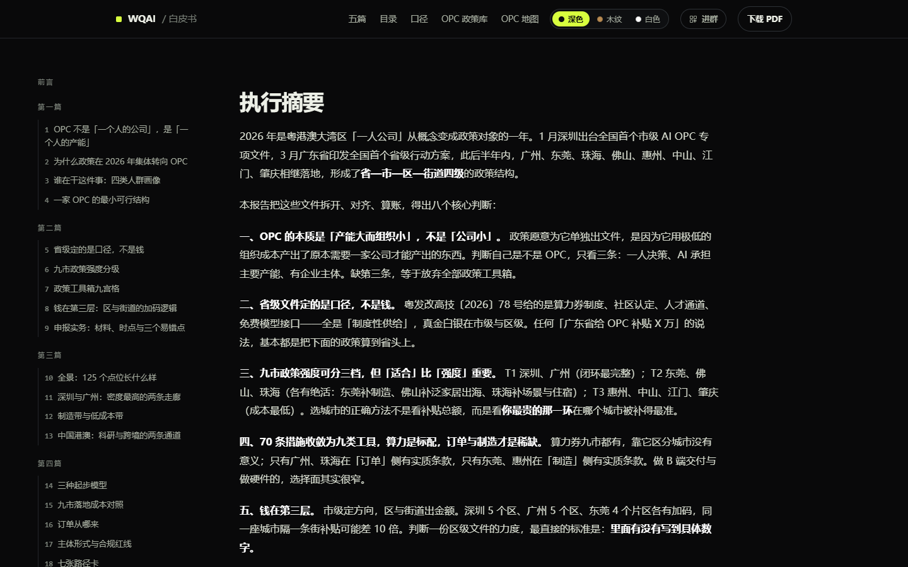
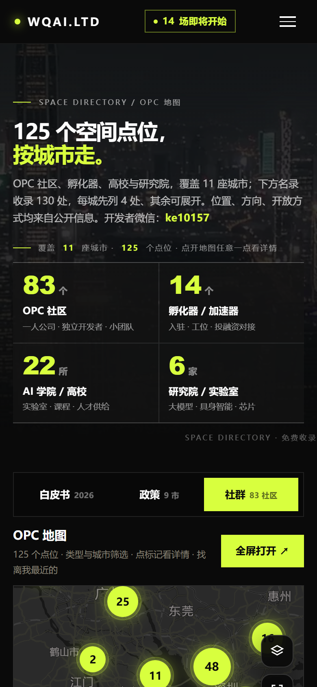

# 粤港澳大湾区 OPC 社区地图 · 九市政策 · 白皮书 2026

**GBA OPC Directory · 9-City Policies · White Paper 2026**

OPC（One Person Company，一人公司）不是「公司很小」，而是「产能大、组织小」。
这个仓库收录 [**wqai.ltd**](https://wqai.ltd) 上 OPC 相关三个板块的说明与截图：
**125 个社区与空间点位**、**珠三角九市扶持力度对比**、**《粤港澳大湾区 OPC 社区白皮书（2026）》**。

> 本仓库只做展示与索引，**不含网站源码，也不含全量名录与政策原文**。
> 点位地址、政策条款一律以 [wqai.ltd](https://wqai.ltd) 原页与政府原文为准。

---

## 网站截图 / Screenshots

> 截图由 [GitHub Actions](.github/workflows/screenshots.yml) 每月 1 号自动从 wqai.ltd 重新截取。
> **点图可直达对应页面。**

### 社区名录 / Space directory

125 个空间点位按城市走，名录收录 130 处：**OPC 社区 83 · 孵化器 / 加速器 14 · AI 学院 / 高校 22 · 研究院 / 实验室 6**。
每处标注位置、方向、开放方式（申请入驻 / 以入驻和活动为主），均来自公开信息。

完整名录长图 / Full directory

### 互动地图 / Interactive map

| 桌面版 | 手机版 |
| --- | --- |
|  |  |

底图由高德地图提供，按城市聚类、按类型筛选、可「找离我最近的」。
坐标为**园区或片区级大致位置**，导航请以地图 App 为准。

### 九市政策 / 9-city policy comparison

| 珠三角九市横向对比 | 深圳 | 广州 |
| --- | --- | --- |
|  |  |  |

对比表按「**算力 / 空间 / 资金 / 人才**」四列横比，把省—市—区—街道四级政策拆到条款层。
截至 2026-10-29 核实，广东九市共 **22 份** OPC 相关政策文件。

### 白皮书 / White paper

| 白皮书首页 | 在线阅读 |
| --- | --- |
|  |  |

**《粤港澳大湾区 OPC 社区白皮书（2026）》v1.0** — 一人公司时代的政策、空间与成本地图。
41 页 PDF（1.2 MB）· 3.2 万字 · 20 章 + 6 个附录 · 数据截止 2026-10-30。

  

---

## 这份名录覆盖什么 / What's inside

### 空间点位：11 座城市，130 处

| 城市 | 点位 | 城市 | 点位 |
| --- | --- | --- | --- |
| 深圳 | 55 | 惠州 | 8 |
| 广州 | 26 | 中国香港 | 7 |
| 东莞 | 10 | 珠海 | 6 |
| 佛山 | 8 | 肇庆 | 5 |
| 中山 | 2 | 中国澳门 | 2 |
| 江门 | 1 | **合计** | **130** |

其中 125 处已标注到地图坐标，其余待定位。深圳 55 处里有 33 家是 OPC 社区。

### 类型

- **OPC 社区**（83）—— 一人公司、独立开发者、小团队，通常配注册代办、算力与订单对接
- **孵化器 / 加速器**（14）—— 入驻、工位、投融资对接
- **AI 学院 / 高校**（22）—— 实验室、课程、人才供给
- **研究院 / 实验室**（6）—— 大模型、具身智能、芯片

### 政策口径

以深圳为例，这页收录 **14 条**政策与官方动态（含 1 份征求意见稿）、**10 项**可申请支持、**34 个**本地 OPC 社区；
市级母文件为《深圳市打造人工智能 OPC 创业生态引领地行动计划（2026—2027 年）》
（深工信〔2026〕2 号，2026-01-14），目标 2027 年底建成超 10 家万平米级 OPC 社区、全市面积超 50 万平米。

> ⚠️ 政策会打补丁、会过期。任何申报动作前，请回到发布单位原文核对最新版本；
> 页面上标注「征求意见稿」「媒体口径」的，都不能当成已经生效的条款。

---

## 三个入口 / Links

| | |
| --- | --- |
| OPC 社区与空间名录 | https://wqai.ltd/space/index.html |
| OPC 互动地图 | https://wqai.ltd/space/map.html |
| 珠三角九市政策对比 | https://wqai.ltd/opc/index.html |
| 白皮书 2026（在线阅读 / PDF） | https://wqai.ltd/report/ |
| 活动与赛事（主站） | https://wqai.ltd/calendar/index.html |

## 收录与免责 / Scope & disclaimer

1. 空间与机构信息来自**公开资料**（政府与园区公开招商信息、官方公众号），标注位置为园区或片区级大致坐标。
2. 本仓库不代收费用、不代办入驻、不为任何机构背书；开放方式与价格以对方公布为准。
3. 发现错误或想收录：开 [Issue](../../issues/new)，或微信 **ke10157**、公众号「湾区AI日历」。
4. 截图仅用于展示本站，不作为场地现状的依据。

## 许可 / License

本仓库的**文字说明**以 [CC BY 4.0](https://creativecommons.org/licenses/by/4.0/deed.zh) 发布，署名即可转载：

> 来源：湾区 AI 日历 wqai.ltd（CC BY 4.0）

机构名称、商标、政策原文的著作权归各自权利人；网站截图仅用于展示本站，不在 CC BY 4.0 范围内。

## 更新节奏 / Update cadence

- 截图：每月 1 号由 GitHub Actions 自动重截（10 张，含手机版）。
- 名录与政策：随 [wqai.ltd](https://wqai.ltd) 同步更新，本站为准。
- 白皮书：版本化发布，v1.0 数据截止 2026-10-30。

## 维护者 / Maintainer

个人维护 · [wqai.ltd](https://wqai.ltd) · 联系 hi@wqai.ltd

---

## English summary

A directory of **125 mapped AI community spaces** (130 listed) for one-person companies across the
Guangdong–Hong Kong–Macao Greater Bay Area — 83 OPC communities, 14 incubators, 22 universities and
6 research labs, spread over 11 cities. Ships alongside a clause-level comparison of OPC support
policies in nine Pearl River Delta cities and the **2026 GBA OPC Community White Paper**
(41 pages, 3.2万字 / 20 chapters + 6 appendices, data cut-off 2026-10-30).

- Every entry links back to its page on [wqai.ltd](https://wqai.ltd); coordinates are district-level.
- Policy figures always defer to the issuing government's original document.
- Screenshots refresh monthly via GitHub Actions; text is CC BY 4.0 with attribution.
